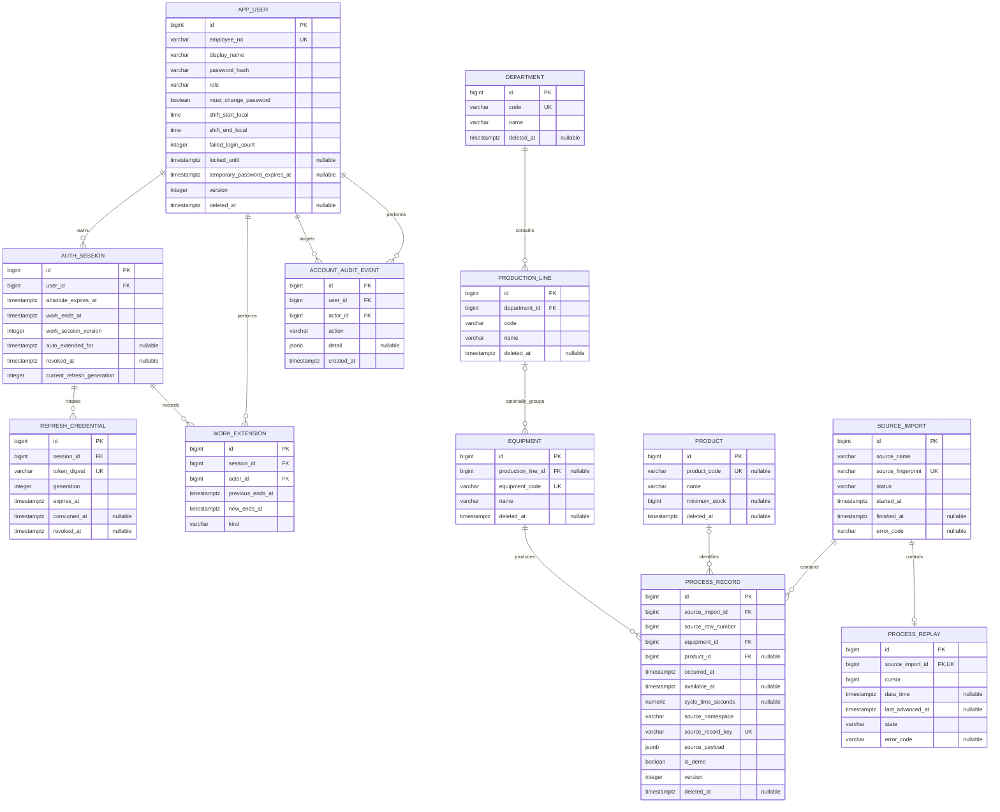

# Backend ERD

기준일: 2026-11-23. 이 문서는 Alembic `20261123_0008` 기준으로 실제 구현된 테이블만 표시한다.
향후 테이블은 마이그레이션이 추가될 때 함께 갱신한다.

모든 테이블에는 `created_at`, `updated_at`이 있으며 도식에서는 반복을 줄이기 위해 생략했다.

## 설계 해석

- `equipment.production_line_id`는 nullable이다. 확인한 CSV에는 생산 라인이 없으므로 임의의 1·2라인을
  배정하지 않는다.
- 설비와 품목은 고정 1:1 관계가 아니다. 품목은 각 `process_record`에서 연결하며 같은 품목이 여러
  설비에서 생산될 수 있다.
- `product.product_code`는 nullable이다. `PART_NO`가 없는 데이터도 적재할 수 있고, 코드가 있으면
  중복을 허용하지 않는다.
- `cycle_time_seconds`는 단위를 컬럼명에 명시한다. 프론트 목업의 분 단위 이름을 DB 계약으로
  사용하지 않는다.
- `(source_import_id, source_row_number)`는 파일 안의 행 위치를 유일하게 식별하고,
  `(source_namespace, source_record_key)`는 여러 파일에 중복된 같은 `_id` 적재를 방지한다. 원본
  전체 값은 `source_payload`에 보존하며 CSV 행 수를 생산 수량으로 해석하지 않는다.
- `available_at`은 재생 중 해당 행이 조회 가능해진 시각이다. 아직 공개되지 않은 적재 행은 null이다.
- 설비 상태, 목표 생산량, 실제 생산 수량, 가동률은 확인한 CSV에 없으므로 현재 스키마에서 추론하지
  않는다.
- `refresh_credential`은 토큰 원문 대신 SHA-256 digest만 저장한다. 재사용 감지를 위해 사용된
  자격 증명 행은 삭제하지 않고 `consumed_at`·`revoked_at`으로 상태를 남긴다.
- `auth_session.absolute_expires_at`은 최초 로그인부터 7일 상한이며, 리프레시를 교체해도 늘어나지
  않는다. 액세스 토큰 만료는 DB에 저장하지 않고 JWT claim으로 관리한다.
- `auth_session.work_ends_at`과 `work_session_version`은 같은 로그인 세션의 여러 탭이 공유한다.
  성공한 수동·자동 연장은 `work_extension`에 변경 전후 시각과 실행자를 기록한다.
- `app_user.temporary_password_expires_at`은 API로 발급한 임시 비밀번호의 만료 시각이다. CLI 시드
  계정은 null로 두어 시간 만료를 적용하지 않는다.
- `account_audit_event`는 계정 생성·초기화·수정·비활성화·재활성화 조치를 추가 기록 방식으로 남긴다.
  `detail`에는 변경 필드의 전후 값만 넣고 임시 비밀번호 원문·해시·만료 시각은 저장하지 않는다.

## 구현 위치

- ORM: `BE/app/models/master.py`, `BE/app/models/process.py`, `BE/app/models/auth.py`,
  `BE/app/models/account_audit.py`
- 마이그레이션: `20261120_0002_core_master.py`, `20261120_0003_process_replay.py`,
  `20261120_0005_auth_session.py`, `20261123_0006_work_session.py`,
  `20261123_0007_temp_password_expiry.py`, `20261123_0008_account_audit.py`
- 상세 규칙과 향후 테이블: [DATABASE_DESIGN.md](DATABASE_DESIGN.md)
