# Backend ERD

기준일: 2026-11-23. 이 문서는 Alembic `20261123_0016` 기준으로 실제 구현된 테이블만 표시한다.
향후 테이블은 마이그레이션이 추가될 때 함께 갱신한다.

```mermaid
erDiagram
    APP_USER {
        bigint id PK
        varchar employee_no UK
        varchar display_name
        varchar password_hash
        varchar role
        boolean must_change_password
        time shift_start_local
        time shift_end_local
        integer failed_login_count
        timestamptz locked_until "nullable"
        timestamptz temporary_password_expires_at "nullable"
        integer version
        timestamptz deleted_at "nullable"
    }

    ACCOUNT_AUDIT_EVENT {
        bigint id PK
        bigint user_id FK
        bigint actor_id FK
        varchar action
        jsonb detail "nullable"
        timestamptz created_at
    }

    AUTH_SESSION {
        bigint id PK
        bigint user_id FK
        timestamptz absolute_expires_at
        timestamptz work_ends_at
        integer work_session_version
        timestamptz auto_extended_for "nullable"
        timestamptz revoked_at "nullable"
        integer current_refresh_generation
    }

    WORK_EXTENSION {
        bigint id PK
        bigint session_id FK
        bigint actor_id FK
        timestamptz previous_ends_at
        timestamptz new_ends_at
        varchar kind
    }

    REFRESH_CREDENTIAL {
        bigint id PK
        bigint session_id FK
        varchar token_digest UK
        integer generation
        timestamptz expires_at
        timestamptz consumed_at "nullable"
        timestamptz revoked_at "nullable"
    }

    DEPARTMENT {
        bigint id PK
        varchar code UK
        varchar name
        timestamptz deleted_at "nullable"
    }

    PRODUCTION_LINE {
        bigint id PK
        bigint department_id FK
        varchar code
        varchar name
        timestamptz deleted_at "nullable"
    }

    EQUIPMENT {
        bigint id PK
        bigint production_line_id FK "nullable"
        varchar equipment_code UK
        varchar name
        timestamptz deleted_at "nullable"
    }

    PRODUCT {
        bigint id PK
        varchar product_code UK "nullable"
        varchar name
        bigint minimum_stock "nullable"
        timestamptz deleted_at "nullable"
    }

    USER_ASSIGNMENT {
        bigint id PK
        bigint user_id FK
        bigint department_id FK "nullable"
        bigint production_line_id FK "nullable"
        bigint equipment_id FK "nullable"
        timestamptz deleted_at "nullable"
    }

    SOURCE_IMPORT {
        bigint id PK
        varchar source_name
        varchar source_fingerprint UK
        varchar status
        timestamptz started_at
        timestamptz finished_at "nullable"
        varchar error_code "nullable"
    }

    PROCESS_RECORD {
        bigint id PK
        bigint source_import_id FK
        bigint source_row_number
        bigint equipment_id FK
        bigint product_id FK "nullable"
        timestamptz occurred_at
        timestamptz available_at "nullable"
        numeric cycle_time_seconds "nullable"
        varchar source_namespace
        varchar source_record_key UK
        jsonb source_payload
        boolean is_demo
        integer version
        timestamptz deleted_at "nullable"
    }

    INSPECTION_RECORD {
        bigint id PK
        bigint equipment_id FK
        bigint product_id FK "nullable"
        bigint process_record_id FK "nullable"
        timestamptz inspected_at
        timestamptz available_at "nullable"
        varchar verdict
        varchar defect_type "nullable"
        varchar reason "nullable"
        boolean is_demo
        integer version
        timestamptz deleted_at "nullable"
    }

    RECORD_CHANGE {
        bigint id PK
        bigint process_record_id FK "nullable"
        bigint inspection_record_id FK "nullable"
        bigint actor_id FK
        varchar operation
        jsonb before_value "nullable"
        jsonb after_value "nullable"
        varchar reason
        integer version
        timestamptz occurred_at
    }

    OPERATION_DAY {
        bigint id PK
        bigint equipment_id FK
        date day
        integer planned_seconds
        integer actual_seconds
        boolean is_demo
    }

    GENERATION_JOB {
        bigint id PK
        bigint requester_id FK
        varchar kind
        varchar client_request_key
        jsonb request_payload
        varchar request_digest
        varchar state
        timestamptz accepted_at
        timestamptz data_cutoff_at "nullable"
        timestamptz claimed_at "nullable"
        timestamptz heartbeat_at "nullable"
        timestamptz lease_expires_at "nullable"
        timestamptz finished_at "nullable"
        varchar error_code "nullable"
        varchar safe_error_message "nullable"
        bigint retry_of_id FK "nullable"
        integer attempt_count
    }

    REPORT {
        bigint id PK
        bigint author_id FK
        bigint generation_job_id FK,UK "nullable"
        varchar title
        text body_markdown
        varchar category
        varchar report_kind
        varchar business_status
        integer version
        bigint last_editor_id FK "nullable"
        timestamptz deleted_at "nullable"
    }

    REPORT_REVISION {
        bigint id PK
        bigint report_id FK
        integer version
        varchar title
        text body_markdown
        bigint editor_id FK
        timestamptz created_at
    }

    REPORT_STATUS_EVENT {
        bigint id PK
        bigint report_id FK
        varchar before_status
        varchar after_status
        bigint actor_id FK
        timestamptz created_at
    }

    HANDOVER_NOTE {
        bigint id PK
        bigint author_id FK
        text body
        integer version
        timestamptz deleted_at "nullable"
    }

    HANDOVER_TARGET {
        bigint id PK
        bigint handover_note_id FK
        bigint department_id FK "nullable"
        bigint production_line_id FK "nullable"
        bigint equipment_id FK "nullable"
    }

    HANDOVER_READ {
        bigint id PK
        bigint handover_note_id FK
        bigint user_id FK
        timestamptz confirmed_at
    }

    STOCK_BALANCE {
        bigint id PK
        bigint product_id FK,UK
        bigint quantity
    }

    STOCK_MOVEMENT {
        bigint id PK
        bigint product_id FK
        bigint actor_id FK
        varchar kind
        bigint delta
        varchar reason "nullable"
        bigint original_movement_id FK "nullable"
        bigint checked_by_id FK "nullable"
        timestamptz checked_at "nullable"
        timestamptz created_at
    }

    SCHEDULE {
        bigint id PK
        bigint author_id FK
        varchar title
        varchar category
        text description "nullable"
        boolean all_day
        date start_date "nullable"
        date end_date_exclusive "nullable"
        timestamptz starts_at "nullable"
        timestamptz ends_at "nullable"
        integer version
        timestamptz deleted_at "nullable"
    }

    PROCESS_REPLAY {
        bigint id PK
        bigint source_import_id FK,UK
        bigint cursor
        timestamptz data_time "nullable"
        timestamptz last_advanced_at "nullable"
        varchar state
        varchar error_code "nullable"
    }

    CONVERSATION {
        bigint id PK
        bigint owner_id FK
        varchar title
        timestamptz deleted_at "nullable"
    }

    CHAT_TURN {
        bigint id PK
        bigint conversation_id FK
        text question
        text answer "nullable"
        bigint active_job_id FK "nullable"
        timestamptz answered_at "nullable"
        jsonb query_scope "nullable"
        timestamptz data_cutoff_at "nullable"
        boolean is_demo "nullable"
    }

    ANSWER_EVIDENCE {
        bigint id PK
        bigint chat_turn_id FK
        bigint report_id FK "nullable"
        bigint process_record_id FK "nullable"
        bigint inspection_record_id FK "nullable"
        bigint product_id FK "nullable"
        integer source_version "nullable"
        timestamptz source_time "nullable"
    }

    DEPARTMENT ||--o{ PRODUCTION_LINE : contains
    PRODUCTION_LINE o|--o{ EQUIPMENT : optionally_groups
    SOURCE_IMPORT ||--o{ PROCESS_RECORD : contains
    SOURCE_IMPORT ||--o| PROCESS_REPLAY : controls
    EQUIPMENT ||--o{ PROCESS_RECORD : produces
    PRODUCT o|--o{ PROCESS_RECORD : identifies
    EQUIPMENT ||--o{ INSPECTION_RECORD : inspects
    EQUIPMENT ||--o{ OPERATION_DAY : runs
    PRODUCT o|--o{ INSPECTION_RECORD : identifies
    PROCESS_RECORD o|--o{ INSPECTION_RECORD : inspected_by
    APP_USER ||--o{ AUTH_SESSION : owns
    AUTH_SESSION ||--o{ REFRESH_CREDENTIAL : rotates
    AUTH_SESSION ||--o{ WORK_EXTENSION : records
    APP_USER ||--o{ WORK_EXTENSION : performs
    APP_USER ||--o{ ACCOUNT_AUDIT_EVENT : targets
    APP_USER ||--o{ ACCOUNT_AUDIT_EVENT : performs
    APP_USER ||--o{ USER_ASSIGNMENT : assigned
    DEPARTMENT o|--o{ USER_ASSIGNMENT : covers
    PRODUCTION_LINE o|--o{ USER_ASSIGNMENT : covers
    EQUIPMENT o|--o{ USER_ASSIGNMENT : covers
    PROCESS_RECORD o|--o{ RECORD_CHANGE : changed
    INSPECTION_RECORD o|--o{ RECORD_CHANGE : changed
    APP_USER ||--o{ RECORD_CHANGE : performs
    APP_USER ||--o{ REPORT : authors
    APP_USER o|--o{ REPORT : last_edited_by
    APP_USER ||--o{ REPORT_REVISION : edits
    APP_USER ||--o{ REPORT_STATUS_EVENT : performs
    REPORT ||--o{ REPORT_REVISION : versions
    REPORT ||--o{ REPORT_STATUS_EVENT : status_changes
    APP_USER ||--o{ GENERATION_JOB : requests
    GENERATION_JOB o|--o{ GENERATION_JOB : retries
    REPORT o|--|| GENERATION_JOB : generated_by
    APP_USER ||--o{ CONVERSATION : owns
    CONVERSATION ||--o{ CHAT_TURN : contains
    GENERATION_JOB o|--o{ CHAT_TURN : generates
    CHAT_TURN ||--o{ ANSWER_EVIDENCE : cites
    REPORT o|--o{ ANSWER_EVIDENCE : cited_by
    PROCESS_RECORD o|--o{ ANSWER_EVIDENCE : cited_by
    INSPECTION_RECORD o|--o{ ANSWER_EVIDENCE : cited_by
    PRODUCT o|--o{ ANSWER_EVIDENCE : cited_by
    APP_USER ||--o{ SCHEDULE : authors
    PRODUCT ||--|| STOCK_BALANCE : balances
    PRODUCT ||--o{ STOCK_MOVEMENT : moves
    APP_USER ||--o{ STOCK_MOVEMENT : performs
    APP_USER o|--o{ STOCK_MOVEMENT : checks
    STOCK_MOVEMENT o|--o{ STOCK_MOVEMENT : corrects
    APP_USER ||--o{ HANDOVER_NOTE : authors
    HANDOVER_NOTE ||--o{ HANDOVER_TARGET : covers
    HANDOVER_NOTE ||--o{ HANDOVER_READ : confirmed_by
    APP_USER ||--o{ HANDOVER_READ : confirms
    DEPARTMENT o|--o{ HANDOVER_TARGET : referenced
    PRODUCTION_LINE o|--o{ HANDOVER_TARGET : referenced
    EQUIPMENT o|--o{ HANDOVER_TARGET : referenced
```

모든 테이블에는 `created_at`, `updated_at`이 있으며 도식에서는 반복을 줄이기 위해 생략했다.

## 설계 해석

- `equipment.production_line_id`는 nullable이다. 확인한 CSV에는 생산 라인이 없으므로 임의의 1·2라인을
  배정하지 않는다.
- 설비와 품목은 고정 1:1 관계가 아니다. 품목은 각 `process_record`에서 연결하며 같은 품목이 여러
  설비에서 생산될 수 있다.
- `product.product_code`는 nullable이다. `PART_NO`가 없는 데이터도 적재할 수 있고, 코드가 있으면
  중복을 허용하지 않는다.
- `cycle_time_seconds`는 단위를 컬럼명에 명시한다. 프론트 목업의 분 단위 이름을 DB 계약으로
  사용하지 않는다.
- `(source_import_id, source_row_number)`는 파일 안의 행 위치를 유일하게 식별하고,
  `(source_namespace, source_record_key)`는 여러 파일에 중복된 같은 `_id` 적재를 방지한다. 원본
  전체 값은 `source_payload`에 보존하며 CSV 행 수를 생산 수량으로 해석하지 않는다.
- `available_at`은 재생 중 해당 행이 조회 가능해진 시각이다. 아직 공개되지 않은 적재 행은 null이다.
- 설비 상태, 목표 생산량, 실제 생산 수량, 가동률은 확인한 CSV에 없으므로 현재 스키마에서 추론하지
  않는다.
- `refresh_credential`은 토큰 원문 대신 SHA-256 digest만 저장한다. 재사용 감지를 위해 사용된
  자격 증명 행은 삭제하지 않고 `consumed_at`·`revoked_at`으로 상태를 남긴다.
- `auth_session.absolute_expires_at`은 최초 로그인부터 7일 상한이며, 리프레시를 교체해도 늘어나지
  않는다. 액세스 토큰 만료는 DB에 저장하지 않고 JWT claim으로 관리한다.
- `auth_session.work_ends_at`과 `work_session_version`은 같은 로그인 세션의 여러 탭이 공유한다.
  성공한 수동·자동 연장은 `work_extension`에 변경 전후 시각과 실행자를 기록한다.
- `app_user.temporary_password_expires_at`은 API로 발급한 임시 비밀번호의 만료 시각이다. CLI 시드
  계정은 null로 두어 시간 만료를 적용하지 않는다.
- `account_audit_event`는 계정 생성·초기화·수정·비활성화·재활성화 조치를 추가 기록 방식으로 남긴다.
  `detail`에는 변경 필드의 전후 값만 넣고 임시 비밀번호 원문·해시·만료 시각은 저장하지 않는다.
- `inspection_record.verdict`는 `good`(양품)·`defect`(불량)만 허용한다. 불량이고 `defect_type`이 비면
  화면·집계에서 ‘미분류’로 본다. 공정 기록과 연결할 키가 없으면 `process_record_id`는 null이다.
- 이력 조회는 `process_record`·`inspection_record`를 `occurred_at`·`inspected_at` 기준으로 조회하며,
  `available_at` 조건 없이 저장된 기록을 조회한다. `available_at`은 미공개 행을 구분하는 값으로 표시한다.
- `user_assignment`는 부서·라인·설비 중 정확히 하나를 대상으로 갖는다(CHECK). 활성 담당은 대상별 부분
  UNIQUE 인덱스로 중복을 막고, 삭제는 soft delete로 처리한다. 담당 대상이 soft delete되면 담당 조회에서
  제외하되 배정은 보존한다(DEC-130·DEC-207).
- `record_change`는 공정·검사 FK 중 정확히 하나를 갖는다(CHECK). 관리자 정정 한 건마다 변경 필드의
  전후 값과 사유·작업자·결과 version·시각을 남기며 토큰 원문처럼 민감한 값은 저장하지 않는다.
  원천 식별자(`source_*`)와 `is_demo`는 정정 대상이 아니다(DEC-158·DEC-208).
- `report`는 본문 Markdown·분류·종류·업무 상태와 version을 갖고 soft delete로 숨긴다. `report_revision`은
  `(report_id, version)` UNIQUE로 최초 버전부터 제목·본문·수정자를 보존하고, `report_status_event`는
  대기·진행 중·완료 전이의 전후 상태·작업자·시각을 남긴다(DEC-137·DEC-188·DEC-209).
- AI 생성·집계 관련 컬럼(기간·기준 시각, 집계 스냅샷 등)은 AI 보고서 생성 작업에서 추가한다. 현재
  `report`는 수동 등록·조회·수정·상태 변경·삭제와 `generation_job_id` 연결만 담는다(DEC-209·DEC-210).
- `generation_job`은 요청자·종류·`client_request_key` UNIQUE로 중복 접수를 막고, `request_digest`로 같은
  키의 다른 내용 충돌을 판정한다. `state`·`lease_expires_at`·`claimed_at`·`heartbeat_at`으로 PostgreSQL
  큐의 claim/lease를 관리하며, 임차가 만료된 작업은 `interrupted`로 정리한다. `retry_of_id`는 재시도
  계보를 잇는다(DEC-094·DEC-210).
- `schedule`은 종일(`start_date`·`end_date_exclusive`, 종료일 제외)과 시간 지정(`starts_at`·`ends_at`) 중
  하나의 표현만 갖는다(CHECK). 종료가 시작보다 뒤여야 하고 유형은 `inspection`·`production`·`meeting`·
  `other`다. version으로 동시 수정을 막고 soft delete한다(DEC-168·DEC-212).
- `stock_balance`는 제품당 1행의 현재고이며 `quantity >= 0`을 CHECK로 보장한다. 거래 등록·정정은
  제품 행을 잠근 뒤 원장(`stock_movement`)과 잔고를 같은 트랜잭션에서 갱신한다. 원장은 유형
  (`initial`·`receipt`·`issue`·`adjustment`·`correction`)·증감·사유·등록자·확인자·원거래 연결을 남기며
  삭제하지 않는다(DEC-085·DEC-086·DEC-139·DEC-213).
- `handover_note`는 본문 Markdown과 version을 갖고 soft delete한다. `handover_target`은 부서·라인·설비 중
  정확히 하나를 대상으로 갖고(CHECK), `handover_read`는 `(handover_note_id, user_id)` UNIQUE로 사용자별
  확인자·확인 시각을 한 번만 기록한다(DEC-090·DEC-091·DEC-214).

## 구현 위치

- ORM: `BE/app/models/master.py`, `BE/app/models/process.py`, `BE/app/models/operation.py`,
  `BE/app/models/auth.py`,
  `BE/app/models/account_audit.py`, `BE/app/models/report.py`, `BE/app/models/report_job.py`,
  `BE/app/models/schedule.py`, `BE/app/models/stock.py`, `BE/app/models/handover.py`,
  `BE/app/models/conversation.py`
- 마이그레이션: `20261120_0002_core_master.py`, `20261120_0003_process_replay.py`,
  `20261120_0005_auth_session.py`, `20261123_0006_work_session.py`,
  `20261123_0007_temp_password_expiry.py`, `20261123_0008_account_audit.py`,
  `20261123_0009_inspection_record.py`, `20261123_0010_user_assignment.py`,
  `20261123_0011_record_change.py`, `20261123_0012_report.py`, `20261123_0013_generation_job.py`,
  `20261123_0014_schedule.py`, `20261123_0015_inventory.py`, `20261123_0016_handover.py`,
  `20261124_0019_conversation.py`, `20261124_0020_operation_day.py`
- 상세 규칙과 향후 테이블: [DATABASE_DESIGN.md](DATABASE_DESIGN.md)
